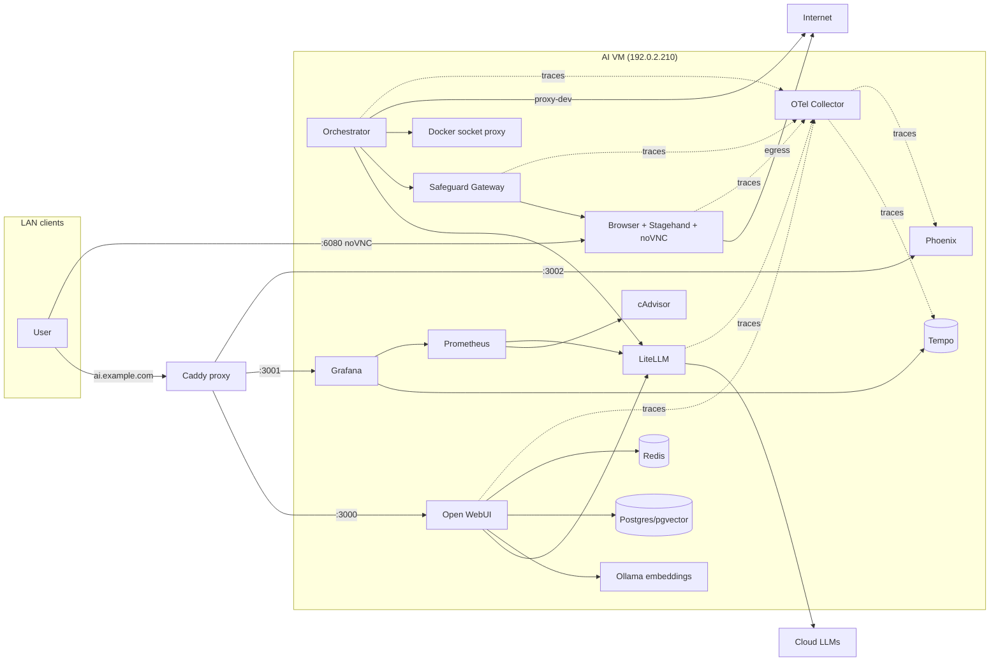

# Homelab AI Stack

Self-hosted AI stack (chat, web/product research, document RAG, coding
assistance) running on a Proxmox VM. Git is the source of truth; Docker Compose
is the deployment mechanism.

## What this is

- **Open WebUI** — chat/RAG UI (PWA).
- **LiteLLM** — the *only* route to model providers: cloud (DeepSeek) and the
  LAN LM Studio host.
- **LM Studio** — external LAN inference host (`192.0.2.20:1234`, OpenAI-compatible),
  fronted by LiteLLM, not deployed by this stack. Serves `google/gemma-4-12b-qat`
  (chat) for local testing only.
- **Ollama** — local embeddings (`bge-m3`, 1024-dim); no local chat LLM.
- **PostgreSQL (pgvector)** — app + vector + budget/approval/audit state.
- **Redis** — cache/queue.
- **Browser (Stagehand)** — headed Chrome + Xvfb + noVNC, driven by
  [Stagehand](https://github.com/browserbase/stagehand) (`act`/`observe`/`extract`
  over Chrome CDP) with LiteLLM as the LLM backend.
- **Safeguard gateway** — SSRF/tier/rate-limit security boundary for the browser,
  plus reader-mode (trafilatura) extraction for plain HTTP fetches.
- **Orchestrator** — LangGraph agent (research / browser / coding approval).
- **Ephemeral coding runner** — aider/opencode in a hardened throwaway container.
- **pgbackup** — nightly Postgres + Open WebUI backups with restore verification.
- **Observability** — Phoenix (LLM traces/evals) + Grafana + Tempo (traces) +
  Prometheus + cAdvisor (metrics), plus Beszel (host + Docker monitoring, hub in
  CT 114). An OTel Collector fans application traces out to both Phoenix and
  Tempo.

## Documentation

- `docs/` — living reference: [web loader](docs/web-loader.md),
  [runbook](docs/runbook.md), [testing](docs/testing.md),
  [benchmarking](docs/benchmarking.md), [privacy](docs/privacy.md).
- `notes/` — dated measurement reports and their [index](notes/README.md).
- `plans/` — approved work plans and the [summary](plans/README.md).
- `decision.md` — append-only decisions, surprises and rejected options.

## Intentionally NOT deployed

Tailscale, Caddy, Authentik, Kubernetes, local GPU services. These already
exist externally or are out of scope. Local chat/embedding models are **not**
run inside this stack — Ollama runs `bge-m3` for embeddings and the LM Studio
host at `192.0.2.20` runs `gemma-4-12b-qat` for local testing; LiteLLM fronts
them as OpenAI-compatible backends.

## Architecture



### Networks

| Network   | Members                              | Internal |
|-----------|--------------------------------------|----------|
| `frontend`| Open WebUI (`:3000`), Grafana (`:3001`), Phoenix (`:3002`) | no |
| `internal`| postgres, redis, litellm, ollama, orchestrator, gateway, browser, otel-collector, phoenix, tempo, prometheus, cadvisor | yes |
| `browser` | gateway, browser, proxy-web           | yes      |
| `agents`  | litellm, proxy-dev, coding runners    | yes      |
| `egress`  | litellm, proxy-web, proxy-dev, gateway (DNS only), browser | no (outbound only) |
| `novnc`   | browser (publishes `:6080` noVNC)     | no       |

`novnc` exists only because Docker cannot publish ports from `internal: true`
networks; the browser's automation/egress traffic stays on the internal
`browser` network, and Chrome reaches the Internet through the `egress` network.
Grafana and Phoenix join `frontend` solely so their ports (`:3001`, `:3002`)
can be published; both are reached only through Caddy. Phoenix also joins
`internal` so the OTel Collector can send it traces.

Containers have no direct Internet access unless on the `egress` network. The
browser reaches the Internet through `egress`; coding runners only through
`proxy-dev` (allowlisted domains) and LiteLLM.

### Storage

| Path  | Backing                        | Contents                                  |
|-------|--------------------------------|-------------------------------------------|
| `/fast`| VM NVMe disk (Docker data-root)| images + named volumes (`pgdata`, `openwebui-data`, `ollama-data`, `browser-profile`, `phoenix-data`, `tempo-data`, `grafana-data`) |
| `/data`| NFS mount of host `/mnt/nasdata/ai` | `uploads`, `workspaces`, `backups`, `bulk` |

`/data` bind mounts use `bind: { create_host_path: false }` so a missing mount
fails instead of writing to the root filesystem. `browser-profile` is never
backed up.

### Resource limits

`mem_limit` values are ceilings, not reservations; the VM has 14 GB and Docker
enforces each service cap independently. See `docker-compose.yml` for per-service limits.

| Service | Limit |
|---|---|
| open-webui | 2 GB |
| litellm | 1.5 GB |
| ollama | 4 GB |
| postgres | 2 GB |
| redis | 256 MB |
| browser | 2.5 GB |
| safeguard-gateway | 512 MB |
| orchestrator | 1 GB |
| docker-socket-proxy | 64 MB |
| proxy-web / proxy-dev | 64 MB each |
| pgbackup | 128 MB |
| otel-collector | 256 MB |
| phoenix | 1 GB |
| tempo | 1 GB |
| prometheus | 256 MB |
| grafana | 512 MB |
| cadvisor | 256 MB |
| agent-runner (ephemeral) | 1.5 GB |

## Setup

1. Provision the VM (see below).
2. `git clone` this repo on the VM.
3. Copy `.env.example` to `.env` and fill in real values (never commit `.env`).
4. `docker compose config` → `docker compose build` → `docker compose up -d`.
5. Create the first Open WebUI admin manually (signup is disabled).

### Required `.env` values

All values are documented with placeholders in `.env.example`. The
security-relevant ones: `POSTGRES_PASSWORD`, `REDIS_PASSWORD`,
`WEBUI_SECRET_KEY`, `LITELLM_MASTER_KEY`, `GATEWAY_TOKEN`,
`ORCHESTRATOR_TOKEN`, `VNC_PASSWORD`, `PHOENIX_SECRET`,
`PHOENIX_DEFAULT_ADMIN_INITIAL_PASSWORD`, `PHOENIX_API_KEY`, and the cloud
provider keys. `FETCH_USER_AGENT` must include a contact address: `sec.gov`
returns 403 to generic user agents. Cloud credentials live **only** in `.env`.

After the first Phoenix login, create a system API key (Settings → API Keys),
set it as `PHOENIX_API_KEY` in `.env`, and restart `otel-collector` so Phoenix
accepts traces.

### Deployment from the host

The VM has no GitHub credentials. Keep the canonical clone on the Proxmox host
and sync committed trees with `scripts/sync-vm.sh` (`git bundle` + fast-forward
merge). It never touches `.env` or named volumes.

```bash
VM_HOST=root@192.0.2.210 ./scripts/sync-vm.sh main
ssh "$VM_HOST" 'cd /opt/ai-stack && docker compose build gateway orchestrator browser && docker compose up -d'
```

If the VM should pull/push directly, add a GitHub deploy key with write access
to `/root/.ssh/` on the VM and keep `origin` as an SSH remote; otherwise treat
the VM as a deployment mirror.

### VM provisioning

The target VM (8 vCPU / 14 GB / 50 GB NVMe root):

```bash
qm create 119 --name ai-stack-vm --memory 14336 --cores 8 --sockets 1 \
  --net0 virtio,bridge=vmbr0 --scsihw virtio-scsi-pci --ostype l26 \
  --agent enabled=1 --serial0 socket --vga serial0 --onboot 1
# import Ubuntu 24.04 cloud image, resize to 50G, attach as scsi0
qm set 119 --ipconfig0 ip=192.0.2.210/24,gw=192.0.2.138
qm set 119 --nameserver 192.0.2.14 --ciuser root --sshkeys /root/.ssh/id_rsa.pub
```

Inside the VM: Docker data-root is `/fast/docker`; `/data` is an NFS mount of
`192.0.2.200:/mnt/nasdata/ai`.

### Firewall requirement

The VM firewall must allow **only** the published ports — `3000` (Open WebUI),
`3001` (Grafana) and `3002` (Phoenix) — and only from the Caddy PCT IP
(`${CADDY_PCT_IP}`, default `192.0.2.28`). `6080` (noVNC) is LAN-only for human
browser control. No other service may be reachable from the LAN. PostgreSQL,
Redis, LiteLLM, Ollama, gateway, orchestrator, OTel Collector, Tempo,
Prometheus and cAdvisor are on `internal` networks and must not be
LAN-accessible.

### Caddy integration

Add Caddyfile entries in CT 110 for `ai` (`:3000`), `grafana` (`:3001`) and
`phoenix` (`:3002`), e.g.:

```caddy
ai.example.com {
    reverse_proxy 192.0.2.210:3000
}
phoenix.example.com {
    reverse_proxy 192.0.2.210:3002
}
```

Restart Caddy (`pct exec 110 -- systemctl restart caddy`), never reload.

## Browser / Stagehand

The browser runs headed Chrome under Xvfb, exposed via noVNC on port `6080`
with the VNC password from `.env`. Chrome is driven by a
[Stagehand](https://github.com/browserbase/stagehand) service that loads its
extension, launches Chrome over CDP, and exposes `act`/`observe`/`extract`
(natural-language browser actions) over a local HTTP API on `:8931`. Stagehand
uses LiteLLM as its LLM backend (`STAGEHAND_MODEL`, default `deepseek-flash`),
so every browser action's token spend flows through LiteLLM's spend log.

The gateway exposes the Stagehand tools to the orchestrator as `stagehand_*`
(`navigate`, `read`, `content`, `act`, `observe`, `extract`, `screenshot`) under
the same SSRF/tier/rate-limit/audit boundary as before. `stagehand_act` is Tier
1 (validated); sensitive actions require approval. `stagehand_content` returns
the rendered DOM HTML, which the orchestrator reduces to reader mode (see
below) before it reaches an agent.

Cookies, history, localStorage and preferences persist in the `browser-profile`
named volume and never leave the container. Reset with
`scripts/browser_reset.sh --yes`.

Two profiles exist conceptually: `anon` (default, persistent, never logged in)
and `personal` (optional, human-managed, only after explicit per-session
approval and only for `PERSONAL_ALLOW_DOMAINS`).

The gateway enforces: SSRF blocking (all RFC1918/link-local/metadata ranges,
`localhost`, internal hostname suffixes, `file://`/`chrome://`/`about:` schemes),
DNS rebinding re-validation on every redirect, URL-length/query/base64
exfiltration limits, tool tiers, 30 req/min/agent, and one page load per 5 s per
domain. Every browser action is audited to `orchestrator.browser_audit`.

On a CAPTCHA / Cloudflare challenge / login wall, the gateway stops and returns
`needs_human: true`; the human resolves it through noVNC.

### Smart web routing

To avoid every query doing *both* a search and a full-page browser load, Open
WebUI exposes an OWUI tool, `smart_web`
(`open-webui/tools/smart_web.py`), and a workspace model, `deepseek-router`
(base `deepseek-flash`), whose system prompt tells the model to pick the
cheapest tool that works:

| Tool          | Backing                                    | Output / use for                          |
|---------------|--------------------------------------------|-------------------------------------------|
| `web_search`  | DuckDuckGo snippets (in-container)         | snippets; general / factual questions     |
| `http_fetch`  | gateway `http_fetch` (plain HTTP, SSRF)    | reader-mode Markdown; static pages, docs  |
| `browse_page` | orchestrator `/web-loader` -> Stagehand    | reader-mode Markdown; JS/interactive      |

`http_fetch` is a Tier-0 gateway tool: it reuses `validate_url` (SSRF) and the
audit log, and the gateway holds the `egress` network, so no browser is needed
for plain HTTP. `web.search.bypass_web_loader` is `true`, so Open WebUI's own
web search returns snippets instead of loading every result through Chrome.

Register (or update) the tool + model once per database with
`scripts/register_smart_web.py`; the DB is included in `pgbackup`, so restores
keep them. The script also applies the sub-agent and web-fetch runtime settings
listed below, so the DB can be rebuilt from Git.

### Reader mode (information per token)

Both page-fetch paths return **reader-mode Markdown** through the shared
extractor (`shared/reader.py`, copied into both images):

- Plain HTTP: `gateway/app.py` calls `read_html(...)` / `extract_pdf(...)`.
- Stagehand: `browser/stagehand-server.mjs` exposes `/content` (rendered
  `document.documentElement.outerHTML`), and the orchestrator calls the same
  `read_html(...)` before returning `/web-loader` content.

The extractor keeps the main article body, headings, lists, tables, code and
comment threads; drops navigation/headers/footers/ads/cookie banners/scripts/
styles; removes clearly hidden nodes and HTML comments; and additionally:

- **Adds context.** Title, h1, meta description and canonical URL are prepended
  (a few tokens); a duplicate leading heading is removed.
- **Compacts links.** Link labels stay inline; unique external URLs are
  appended once under `Sources:`, capped by budget with an omitted-link marker.
  `links=sources|inline|none` is per call. `javascript:`/`mailto:`/`tel:` and
  fragment links are never sources.
- **Preserves structure.** Tables become Markdown pipe tables, code fences and
  lists survive, and XBRL/data pages use table mode. Thread pages use a
  dedicated HN/Stack Exchange/generic thread mode with author, order, depth,
  low-signal collapse and quoted-text dedupe.
- **Detects page type** (article, news, blog, docs, tutorial, thread, listing,
  table, paper, PDF, product, SPA, paywall, challenge) and uses it for budgets
  and extraction mode. Detection is heuristic; `unknown` is the safe fallback.
- **Uses page-type budgets, not domain budgets.** 24k article, 12k news/blog/
  product/SPA/docs, 40k tutorial, 16k thread, 24k paper/PDF/table, 8k listing,
  hard max 48k. Ceilings are measured, not targets.
  `READER_BUDGET_OVERRIDES` is a deployment escape hatch, not a domain rule.
- **Handles PDFs** with `pypdf`, page markers (`[page N]`), encrypted/no-text/
  corrupt clean messages, and no OCR. Binary/unknown content is rejected with a
  short message, never decoded into the model.
- **Detects challenge/paywall pages** in raw HTML and rendered content and
  returns a clean refusal (`needs_human`/`[paywall]`) instead of junk.
- **Caches HTTP fetches** briefly (`WEB_LOADER_CACHE_TTL`, default 300 s),
  respects `no-store`/`no-cache`, and supports `cache=0`. This saves network and
  parse cost, not the tokens of text the model reads.
- **Budgets sub-agent tool output** cumulatively (`[budget_exceeded] ...`) in
  addition to the iteration cap.
- **Avoids trafilatura's stateful `deduplicate=True`.** In 2.3.x it keeps
  cross-call state and starts returning empty output after repeated extractions
  of the same page; the workaround is `deduplicate=False` and a regression test.
- **Wraps page text as untrusted content** at the service boundary and strips
  hidden/comment instructions where the extractor allows.
- Runs extraction in a worker thread, retries transient connect/read failures,
  and emits structured logs/metrics (`/metrics` on gateway/orchestrator).

Caps: page-type ceilings above; `browse_page` and `/web-loader` return the
loader's page-type budget (hard max 48k); Open WebUI `fetch_url` uses
`web.fetch.max_content_length=48000` to preserve those ceilings, not to apply a
second cap.

Fixed-budget token counts are misleading: at a hard cap both methods fill the
cap. The useful metric is the **minimum budget that keeps all key facts**. See
`notes/reader-mode-token-savings-2026-10-26.md`,
`notes/reader-benchmark-2026-10-26.md` and `scripts/bench_reader.py`.

### Sub-agents

Open WebUI's sub-agent (`delegate_task`) runs each sub-task with the selected
model and inherited tool IDs, but **not** the workspace model's system prompt.
Without guidance they used the unbounded builtin `fetch_url`, looped past the
iteration cap, and grew the context until DeepSeek closed the stream. The
registered runtime config (`scripts/register_smart_web.py`) therefore sets:

| Key                              | Value | Why                                      |
|----------------------------------|-------|------------------------------------------|
| `subagents.enable`               | true  | expose `delegate_task`                   |
| `subagents.background_enabled`   | false | foreground only (no orphaned tasks)      |
| `subagents.max_concurrent`       | 3     | limit parallel upstream streams          |
| `subagents.max_iterations`       | 40    | hard bound; <20 calls plus batching fits |
| `subagents.max_output`           | 30000 | per-sub-agent output ceiling             |
| `subagents.system_prompt`        | (see script) | prefer `http_fetch`, <20 tool calls |
| `web.fetch.max_content_length`   | 48000 | preserve loader page-type ceilings      |

LiteLLM also retries transient provider drops (`num_retries: 3`,
`request_timeout: 600`) because DeepSeek occasionally closes a long stream.
Sub-agents run foreground and return their result to the lead agent; a failed
sub-agent is reported as an error string, not a crashed chat.

## Security model

- LiteLLM is the only egress to cloud providers; all other cloud access is
  blocked at the network layer.
- A **secret guard** (LiteLLM pre-call callback) rejects prompts containing AWS
  keys, `sk-...`, GitHub tokens, PEM private keys, or `.env`-style `KEY=`
  assignments with long values. RAG chunks pass unless they match these rules.
- The **gateway** is the browser security boundary (Stagehand is not).
  Unknown/forbidden tools return 403; sensitive fields are blocked; sensitive
  `stagehand_act` instructions require approval.
- Coding runners are ephemeral, non-root, `cap_drop: ALL`,
  `no-new-privileges`, `pids_limit`, 1.5 GB, `agents` network only, no push
  credentials, never merge/push.

## Approval workflow

1. A coding request is analyzed and a plan is generated.
2. An `approvals` row is created with status `pending`; the workspace is **not**
   modified.
3. Open WebUI surfaces the plan + `approval_id` (see
   `open-webui/functions/approval.py`).
4. Approve → the orchestrator spawns one ephemeral runner on a throwaway
   worktree. Reject → task ends with no retry. Edit → re-planning.
5. After execution, `git diff --name-only` must contain only approved files;
   otherwise the worktree is discarded and the task fails.

## Backups

`pgbackup` runs nightly (2:00 AM) and writes to `/data/backups`, retaining 7
days. It dumps every database and tars Open WebUI data. It refuses to run
unless `/data` is a real NFS mountpoint. Verify restores with
`scripts/restore_test.sh`. Off-site backup is left as a documented hook (e.g.
rclone) — no always-on off-site service is deployed.

## Development

```bash
python3 -m venv .venv
.venv/bin/pip install -r requirements-dev.txt
make verify
make bench
pytest -q --run-slow   # opt-in heavy offline tests
```

Network/LLM tests are opt-in (`--run-network`, `--run-llm`). See
`docs/testing.md`, `docs/benchmarking.md` and `docs/runbook.md`.

## Deviations from the original specification

1. **Storage sizing** — the 512 GB NVMe is the Proxmox boot disk; the VM root
   disk (which doubles as `/fast`) is 50 GB. `/data` is a dedicated NFS
   subdirectory of the host's existing 4 TB DAS (`/mnt/nasdata/ai`), not a
   separate disk.
2. **Open WebUI env names** — `ENABLE_TAGS_GENERATION` (plural), `RAG_OLLAMA_BASE_URL`
   (not `RAG_EMBEDDING_BASE_URL`), `VECTOR_DB=pgvector`. `DO_NOT_TRACK`/
   `ANONYMIZED_TELEMETRY`/`SCARF_NO_ANALYTICS` are set per policy but are
   vestigial in current Open WebUI (telemetry is opt-in OTel, off by default).
3. **LiteLLM** — `drop_params` lives under `litellm_settings` (not
   `general_settings`). Self-hosted LiteLLM runs no telemetry by default. Model
   IDs are set from current docs (`bedrock/us.anthropic.claude-sonnet-5`,
   `openai/gpt-5`, `gemini/gemini-2.5-pro`, `deepseek/deepseek-flash`) and should
   be re-verified against provider docs at deploy time.
4. **docker-socket-proxy** — its `CONTAINERS=1` bundles create/start/stop/list
   under one flag; finer separation is not possible in that image.
5. **Open WebUI approval buttons** — the Function renders the plan + approval id;
   interactive Approve/Edit/Reject buttons depend on the exact Open WebUI event
   API of the installed version. The decision API
   (`POST /approvals/{id}/decision`) is always available programmatically.
6. **Stagehand driver** — the browser is driven by Stagehand (act/observe/extract)
   rather than the Playwright MCP server; scrolling is a natural-language `act`
   instruction. The Stagehand service launches Chrome itself (with its extension
   pre-loaded) over CDP on port 9222.
7. **noVNC port + `novnc` network** — Docker cannot publish ports from
   `internal: true` networks, so the browser also attaches to a dedicated
   non-internal `novnc` network solely to publish noVNC (`:6080`). Chrome reaches
   the Internet via the `egress` network, and the gateway's SSRF rules remain the
   security boundary.
8. **Gateway DNS** — `internal: true` networks do not forward external DNS, so
   the safeguard gateway also joins the `egress` network solely to resolve
   hostnames for SSRF validation. The gateway is trusted, publishes no ports,
   and remains LAN-inaccessible.

## Known limitations

- End-to-end cloud chat and coding-runner execution require provider
  credentials in `.env` (DeepSeek at minimum) and were not fully exercised
  without them.
- The coding-runner workspace permission model (orchestrator root vs runner
  uid 1000 on the NFS mount) needs a shared GID for multi-user use; single-user
  works with `chown` on the worktree.
- Browser profile switching (`anon` vs `personal`) is human-managed via noVNC.
- Sub-agents inherit the selected model and tool IDs but not the workspace
  model's system prompt; their behaviour is steered by
  `subagents.system_prompt`. The upstream provider can still close a very long
  stream; LiteLLM retries reduce, but do not eliminate, those failures.
- Stagehand is rate-limited to one page load per 5 s per domain, so bulk
  static-page fetches should stay on `http_fetch`.
- Raw SEC XBRL statement pages are not article content; the extractor detects
  the IDEA/XBRL marker and returns the statement table. Table extraction is
  heuristic and may drop non-table context; table mode says so. Long narrative
  filings are still truncated at the page-type ceiling; this is not a filing
  parser.
- PDF extraction does not OCR scanned pages; encrypted PDFs and files with no
  text return a clean message.
- Thread detection is heuristic; when structure is not confident the loader
  falls back to reader mode. Author/time/depth are best-effort.
- Page-type detection is heuristic; `unknown` falls back to the general budget.
- Progressive outline/section/query loading exists as an opt-in (`mode=...`),
  but is not the default; no A/B has shown fewer total tokens yet.
- The runtime token counter is a tiktoken/char proxy, not DeepSeek usage.
- `browser/package.json` overrides Stagehand's pinned `zod` with `4.6.7` to
  avoid GHSA-mrhx-c7xc-m3w5 (zod memory exhaustion). This is a patch-compatible
  override; re-check it when Stagehand bumps its own pin.
